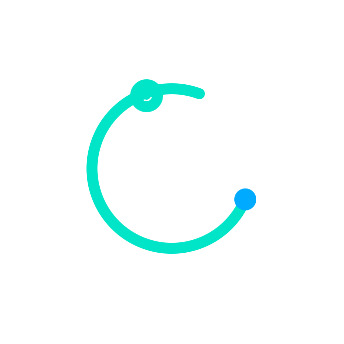
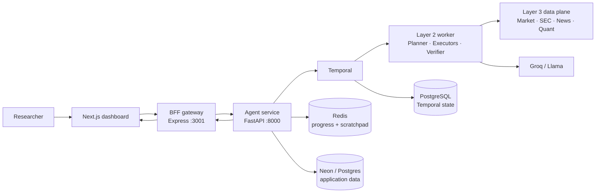
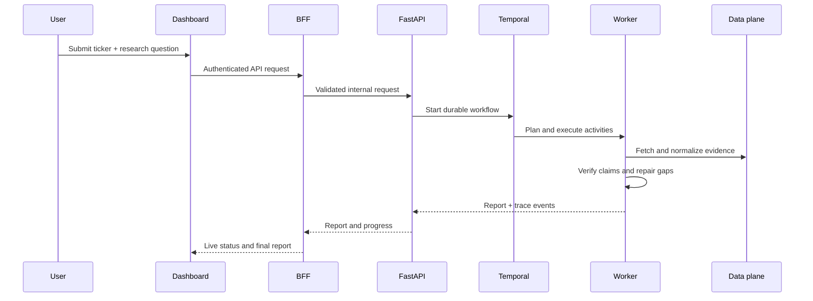
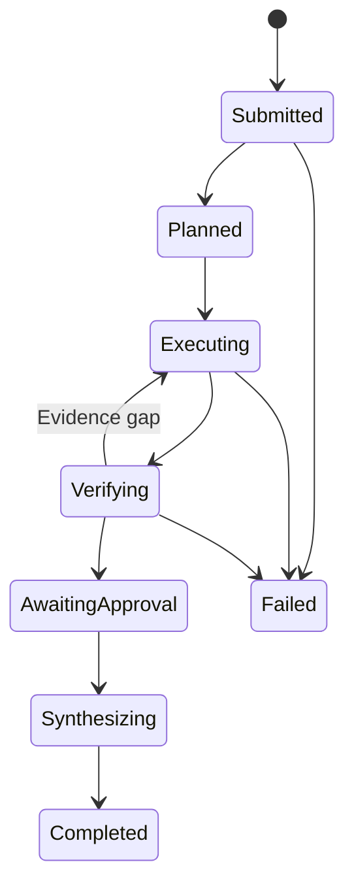

<div align="center">

<a href="https://github.com/deekshithgowda85/Orion">
  
</a>

# Orion

### Evidence-driven market intelligence, from research request to verified report.

<p>
  <a href="https://github.com/deekshithgowda85/Orion/stargazers"></a>
  <a href="https://github.com/deekshithgowda85/Orion/issues"></a>
  <a href="https://github.com/deekshithgowda85/Orion"></a>
</p>

<p>
  <strong>Next.js</strong> · <strong>FastAPI</strong> · <strong>Temporal</strong> · <strong>Redis</strong> · <strong>PostgreSQL</strong> · <strong>Groq / Llama</strong>
</p>

<svg width="760" height="90" viewBox="0 0 760 90" role="img" aria-label="Animated Orion research pipeline">
  <defs>
    <linearGradient id="orion-gradient" x1="0%" y1="0%" x2="100%" y2="0%">
      <stop offset="0%" stop-color="#7c3aed" />
      <stop offset="50%" stop-color="#0ea5e9" />
      <stop offset="100%" stop-color="#22c55e" />
    </linearGradient>
    <style>
      .orion-line { stroke: url(#orion-gradient); stroke-width: 3; stroke-dasharray: 8 10; animation: orion-flow 2.4s linear infinite; }
      .orion-node { fill: #111827; stroke: #a78bfa; stroke-width: 2; animation: orion-pulse 2.4s ease-in-out infinite; }
      @keyframes orion-flow { to { stroke-dashoffset: -36; } }
      @keyframes orion-pulse { 50% { stroke: #38bdf8; r: 13; } }
      @media (prefers-reduced-motion: reduce) { .orion-line, .orion-node { animation: none; } }
    </style>
  </defs>
  <line class="orion-line" x1="55" y1="45" x2="185" y2="45" />
  <line class="orion-line" x1="205" y1="45" x2="335" y2="45" />
  <line class="orion-line" x1="355" y1="45" x2="485" y2="45" />
  <line class="orion-line" x1="505" y1="45" x2="635" y2="45" />
  <circle class="orion-node" cx="45" cy="45" r="10" />
  <circle class="orion-node" cx="195" cy="45" r="10" style="animation-delay:.3s" />
  <circle class="orion-node" cx="345" cy="45" r="10" style="animation-delay:.6s" />
  <circle class="orion-node" cx="495" cy="45" r="10" style="animation-delay:.9s" />
  <circle class="orion-node" cx="645" cy="45" r="10" style="animation-delay:1.2s" />
  <text x="45" y="78" fill="#94a3b8" font-size="12" text-anchor="middle">Request</text>
  <text x="195" y="78" fill="#94a3b8" font-size="12" text-anchor="middle">Plan</text>
  <text x="345" y="78" fill="#94a3b8" font-size="12" text-anchor="middle">Research</text>
  <text x="495" y="78" fill="#94a3b8" font-size="12" text-anchor="middle">Verify</text>
  <text x="645" y="78" fill="#94a3b8" font-size="12" text-anchor="middle">Report</text>
</svg>

</div>

Orion is a modular market-intelligence platform for turning a research question into a traceable, citation-aware report. It combines durable workflow orchestration, specialist research agents, external data tools, an API boundary, and a focused dashboard.

> **Local-first:** the dashboard can run in deterministic mock mode without Clerk, Neon, Groq, or external data provider keys.

## Contents

- [What Orion does](#what-orion-does)
- [Architecture](#architecture)
- [Repository layout](#repository-layout)
- [Requirements](#requirements)
- [Quick start](#quick-start)
- [Full Docker stack](#full-docker-stack)
- [Configuration](#configuration)
- [Development commands](#development-commands)
- [Testing](#testing)
- [Service endpoints](#service-endpoints)
- [Workflow lifecycle](#workflow-lifecycle)
- [Security and operations](#security-and-operations)
- [Troubleshooting](#troubleshooting)

## What Orion does

- Accepts a ticker and a natural-language research question.
- Plans work across market data, filings, news, and quantitative analysis.
- Runs durable workflows with Temporal and streams progress through Redis.
- Verifies claims and supports a verifier/self-correction loop.
- Produces a report with traceable evidence and confidence signals.
- Exposes a Next.js dashboard, a BFF gateway, and a FastAPI agent service.
- Keeps provider integrations behind a data-plane registry and injector boundary.

## Architecture



### Request flow



## Repository layout

| Path | Responsibility |
| --- | --- |
| `frontend/` | Next.js 15 dashboard, auth boundary, workflow UI, charts |
| `api-server/bff_gateway/` | Express BFF, rate limiting, headers, auth proxying |
| `api-server/agent_service/` | FastAPI API, workflow submission, persistence, integrations |
| `agent-l1/` | Temporal workflow contracts, triggers, CLI, orchestration stubs |
| `agent-l2/` | Planner, parallel executors, verifier, synthesizer, Groq client |
| `data_plane/` | Market, SEC, scraping, quant, vector-store, and scratchpad tools |
| `public/` | Static assets, including the Orion logo |
| `docker-compose.yml` | Complete local stack |
| `docker-compose.dev.yml` | Frontend-only mock development container |
| `start-dev.ps1` / `stop-dev.ps1` | Windows development helpers |

## Requirements

- Docker Desktop with the Linux engine enabled
- Node.js 20+
- Python 3.12+ for the current root/layer development path
- PowerShell on Windows
- Git

External keys are **not** needed for the mock dashboard path. Provider-backed research additionally needs the keys listed in [Configuration](#configuration).

## Quick start

This is the fastest path to a working dashboard and local infrastructure:

```powershell
git clone https://github.com/deekshithgowda85/Orion.git
Set-Location Orion
.\start-dev.ps1
```

Open [http://localhost:3000](http://localhost:3000). The helper starts PostgreSQL, Redis, Temporal, and Temporal UI, then starts the frontend in deterministic mock mode.

Stop the development infrastructure with:

```powershell
.\stop-dev.ps1
```

### Frontend-only development

```powershell
docker compose -f docker-compose.dev.yml up
```

This mounts `frontend/` into a Node 20 container and hot-reloads source changes. The dashboard is available at [http://localhost:3000](http://localhost:3000).

## Full Docker stack

Copy the service templates and add real values where required:

```powershell
Copy-Item agent-l2\.env.example agent-l2\.env
Copy-Item api-server\agent_service\.env.example api-server\agent_service\.env
Copy-Item api-server\bff_gateway\.env.example api-server\bff_gateway\.env
```

Build and start every service:

```powershell
docker compose build
docker compose up -d
docker compose ps
```

The default compose configuration builds the dashboard in keyless mock mode. For a real authenticated deployment, set `NEXT_PUBLIC_MOCK_MODE=false` and provide a valid Clerk publishable key in the root `.env`.

```powershell
docker compose logs -f agent-service
docker compose down
docker compose down -v  # also removes local database and Redis volumes
```

## Configuration

The root `.env.example` contains local port and frontend defaults. Never commit `.env` files or provider credentials.

| Variable | Used by | Purpose |
| --- | --- | --- |
| `CLERK_SECRET_KEY` | BFF | Server-side Clerk verification |
| `CLERK_PUBLISHABLE_KEY` | BFF / frontend | Browser authentication |
| `CLERK_JWKS_URL` | FastAPI | JWT signature verification |
| `CLERK_ISSUER` | FastAPI | JWT issuer validation |
| `NEON_DATABASE_URL` | FastAPI / BFF | Tenant, run, report, and citation data |
| `GROQ_API_KEY` | Layer 2 worker | Llama planner, executors, verifier, and synthesis |
| `POLYGON_API_KEY` | Data plane | Market data |
| `FIRECRAWL_API_KEY` | Data plane | Web and news scraping |
| `LLAMA_CLOUD_API_KEY` | Data plane | Filing parsing |
| `E2B_API_KEY` | Data plane | Quant sandbox execution |
| `INNGEST_EVENT_KEY` | Optional triggers | Inngest event delivery |
| `INNGEST_SIGNING_KEY` | Optional triggers | Inngest signature validation |
| `INTERNAL_API_KEY` | Optional schedules | Internal schedule protection |

Default host ports can be changed in `.env`:

```dotenv
POSTGRES_PORT=5433
REDIS_PORT=6380
TEMPORAL_PORT=7234
TEMPORAL_UI_PORT=8081
NEXT_PUBLIC_MOCK_MODE=true
```

## Development commands

### Frontend

```powershell
Set-Location frontend
npm install
npm run dev:mock       # no backend or Clerk keys
npm run lint
npm run typecheck
npm run build
npm run start
```

### BFF gateway

```powershell
Set-Location api-server\bff_gateway
npm install
npm run dev
npm run typecheck
npm run test
npm run build
```

### Layer 2 agent

```powershell
Set-Location agent-l2
py -3.12 -m venv .venv
.\.venv\Scripts\python.exe -m pip install -r requirements.txt
Copy-Item .env.example .env
.\.venv\Scripts\python.exe -m tests.test_offline
```

Standalone demos require `GROQ_API_KEY`:

```powershell
.\.venv\Scripts\python.exe -m agents.planner
.\.venv\Scripts\python.exe -m agents.graph
```

### Layer 3 data plane

```powershell
Set-Location data_plane
py -3.12 -m venv .venv
.\.venv\Scripts\python.exe -m pip install -r requirements.txt
Copy-Item .env.example .env
.\.venv\Scripts\python.exe -m tools.market_data
```

### API service

```powershell
Set-Location api-server\agent_service
py -3.12 -m venv .venv
.\.venv\Scripts\python.exe -m pip install -r requirements.txt -r requirements-dev.txt
.\.venv\Scripts\python.exe -m pytest -q
```

## Testing

Run the smallest relevant check while iterating:

```powershell
# Layer 2 offline checks
Set-Location agent-l2
.\.venv\Scripts\python.exe -m tests.test_offline

# FastAPI tests
Set-Location ..\api-server\agent_service
.\.venv\Scripts\python.exe -m pytest -q

# Gateway checks
Set-Location ..\bff_gateway
npm run typecheck
npm run test

# Dashboard checks
Set-Location ..\..\frontend
npm run lint
npm run typecheck
npm run build
```

## Service endpoints

| Service | Local URL | Notes |
| --- | --- | --- |
| Dashboard | [http://localhost:3000](http://localhost:3000) | Next.js UI |
| BFF gateway | [http://localhost:3001](http://localhost:3001) | Authenticated browser boundary |
| FastAPI service | [http://localhost:8000](http://localhost:8000) | Agent and workflow API |
| Temporal UI | [http://localhost:8081](http://localhost:8081) | Workflow visibility |
| PostgreSQL | `localhost:5433` | Temporal persistence in root compose |
| Redis | `localhost:6380` | Events and scratchpad |

The Layer 1 standalone compose uses its own defaults, including Temporal UI on port `8080`. Check the layer-specific README before running it independently.

## Workflow lifecycle



Layer 2 currently uses synthetic fixtures unless the Layer 3 injector is wired into the graph. Layer 1 intentionally retains orchestration stubs for contract and workflow testing.

## Security and operations

- Keep all `.env` files and credentials outside version control.
- Use Clerk verification at the BFF/API boundary in non-mock deployments.
- Keep provider keys server-side; do not expose them through `NEXT_PUBLIC_*` variables.
- Use `docker compose down -v` only when intentionally deleting local state.
- Review rate limiting, CORS, and security headers before exposing the BFF publicly.
- Pin and review dependency updates before production rollout.

## Troubleshooting

**Docker services do not become healthy**

```powershell
docker compose ps
docker compose logs temporal
docker compose logs postgres
```

Ensure Docker Desktop is running with the Linux engine enabled and that ports `3000`, `3001`, `5433`, `6380`, `7234`, `8000`, and `8081` are available.

**The dashboard starts but API calls fail**

Use `npm run dev:mock` for a backend-free demo, or start the full compose stack. Confirm that `BFF_URL`/service URLs match the selected execution path.

**A provider-backed run has no evidence**

Check the relevant provider key, then confirm that Layer 3 has been initialized and wired into Layer 2. The default Layer 2 `tool_hook.py` path intentionally returns no real external data.

## Contributing

1. Create a focused branch.
2. Keep secrets out of commits.
3. Add or update tests for behavior changes.
4. Run the relevant lint, typecheck, and test commands.
5. Open a pull request with a concise description and validation notes.

## License

No license has been declared yet. Add a `LICENSE` file before distributing Orion outside the repository.
